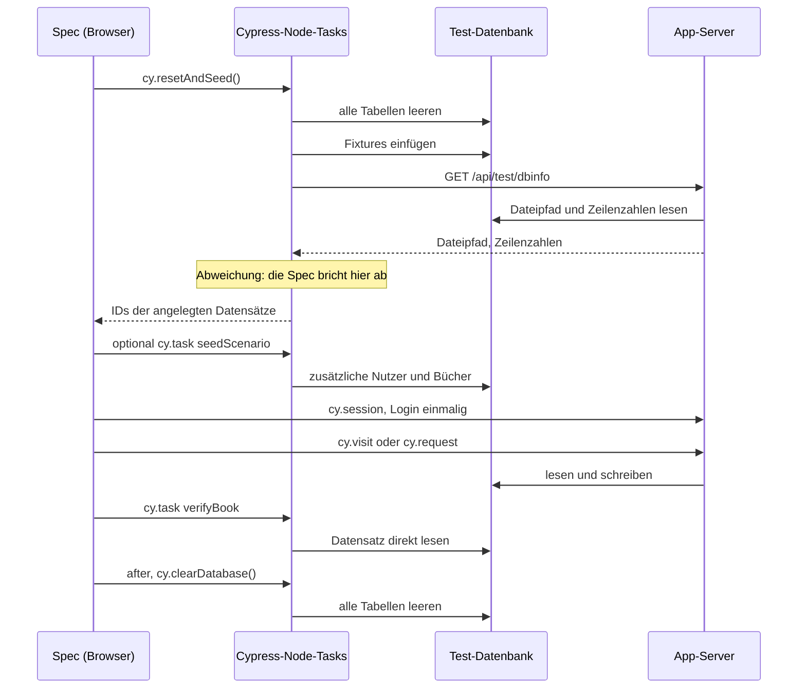

# Tests

OpenLibry verwendet [Cypress](https://www.cypress.io/) für End-to-End-Tests. Ein Testlauf startet die App in einem Testmodus mit einer eigenen, kurzlebigen Datenbank, spielt definierte Testdaten ein und prüft das Verhalten über die Oberfläche und über die API.

Die Tests liegen in `cypress/e2e/`, die Testdaten in `cypress/fixtures/`, die Hilfsfunktionen in `cypress.config.ts` und `cypress/support/`.

## Einrichtung

Einmalig vor dem ersten Lauf:

```bash
npm install
cp .env.test.local.example .env.test.local
```

`.env.test.local` wird nicht eingecheckt. Dieselbe Datei liest der App-Server **und** die Cypress-Konfiguration, damit beide immer dieselbe Datenbank und dieselben Ausleihregeln verwenden. Die wichtigsten Schlüssel:

| Schlüssel | Bedeutung |
|---|---|
| `DATABASE_URL` | Muss `file:./prisma/database/automated-test-db.db` sein. Diese Datei befüllt Cypress. |
| `AUTH_ENABLED` | `true`, denn die Tests melden sich an. |
| `E2E_TEST_MODE` | `true` schaltet den Datenbank-Check frei (siehe unten). Niemals auf einer echten Installation setzen. |
| `RENTAL_DURATION_DAYS`, `EXTENSION_DURATION_DAYS`, `MAX_EXTENSIONS` | Ausleihregeln. Die Tests berechnen erwartete Fälligkeitsdaten daraus. |
| `COVERIMAGE_FILESTORAGE_PATH` | Muss ein Wegwerf-Ordner sein, z. B. `./prisma/database/test-images`. Hochgeladene und gelöschte Cover der Tests landen dort. |
| `OPENLIBRY_LOCALE`, `NEXT_PUBLIC_OPENLIBRY_LOCALE` | `de`, denn die Tests prüfen deutsche Texte. |

!!! warning "Nie auf die echte Datenbank zeigen"
    Jede Spec leert alle Tabellen der Test-Datenbank. `DATABASE_URL` in `.env.test.local` darf niemals auf eine Datenbank mit echten Daten zeigen, und `COVERIMAGE_FILESTORAGE_PATH` nicht auf den Ordner mit echten Covern.

## Tests starten

| Befehl | Was passiert | Wofür |
|---|---|---|
| `npm run test:e2e` | Vorbereiten, App starten, alle Specs headless ausführen, App beenden | Die komplette Suite (ca. 4 Minuten) |
| `SPEC=cypress/e2e/rental.cy.ts npm run test:e2e:spec` | Dasselbe für eine Datei. Auch ein Muster geht: `SPEC="cypress/e2e/rental*.cy.ts"` | An einem Bereich arbeiten |
| `npm run test:e2e:ui` | Vorbereiten, App starten, Cypress-Fenster öffnen | Specs beobachten und debuggen |
| `npm run test:e2e:publicroot` | Startet die App mit dem Katalog als Startseite und führt nur `rootroute-public.cy.ts` aus | Die eine Spec, die diese Servereinstellung braucht |

Alle Befehle brauchen **ein** Terminal: Sie bereiten die Datenbank vor, starten und beenden den Server selbst.

Der Testserver läuft auf Port 3000. Ist der belegt, etwa durch eine laufende OpenLibry-Instanz, setze `PORT` beim Aufruf: `PORT=3100 npm run test:e2e`. Die Variable muss auf der Kommandozeile stehen, in `.env.test.local` wirkt sie nicht. Die Skripte setzen `NEXTAUTH_URL` passend dazu, sonst würde der Login weiter Port 3000 ansprechen. Specs verwenden deshalb nur relative Pfade wie `cy.visit("/book")`, nie `http://localhost:3000`.

!!! note "Rufe `cypress run` nicht direkt auf"
    Ohne die npm-Skripte fehlen die Vorbereitung und der laufende Testserver. Der Datenbank-Check bricht dann mit einer Meldung ab, die den Fehler benennt.

## Ablauf eines Testlaufs

### 1. Vorbereiten

Vor jedem `test:e2e*`-Skript läuft automatisch `test:e2e:prepare`:

1. Der Cover-Ordner der Tests wird gelöscht und leer neu angelegt.
2. Die alte Test-Datenbank (`automated-test-db.db` samt WAL-Dateien) wird gelöscht.
3. `prisma db push` erzeugt eine frische, leere Datenbank aus `schema.prisma`, danach läuft `prisma generate`.

Dadurch beginnt jeder Lauf mit dem aktuellen Schema und ohne Reste früherer Läufe. Das Vorbereiten läuft **nicht**, wenn du `cypress run` direkt aufrufst. Führe es auch nie aus, während der Testserver läuft: Der Server hielte dann die gelöschte Datei weiter offen.

### 2. Starten

`start-server-and-test` startet `next dev` mit den Werten aus `.env.test.local`, wartet bis `localhost:3000` (oder der Port aus `PORT`) antwortet und startet dann Cypress. Beim Start der Cypress-Konfiguration passiert Folgendes:

- Die Ausleihregeln aus `.env.test.local` werden als `Cypress.env(...)` bereitgestellt.
- Die Fixtures werden einmal geladen.
- Es wird **eine** Datenbankverbindung für den gesamten Lauf geöffnet. Sie bleibt zwischen den Specs offen.
- `rootroute-public.cy.ts` wird übersprungen, außer im Befehl `test:e2e:publicroot`.

### 3. Jede Spec-Datei

Jede Datei bereitet ihre Daten selbst vor und räumt danach auf. Deshalb sind alle Dateien voneinander unabhängig und lassen sich einzeln ausführen. Das folgende Diagramm zeigt den Ablauf:



Es sind zwei getrennte Prozesse, die dieselbe Datei verwenden: die Cypress-Node-Seite (Seeding und direkte Prüfungen) und der App-Server (alles, was der Browser auslöst). Der Datenbank-Check stellt sicher, dass beide wirklich dieselbe Datei sehen.

### 4. Beenden

Nach dem Lauf schließt Cypress seine Datenbankverbindung, `start-server-and-test` beendet den Server und gibt den Exit-Code von Cypress zurück. Die (leere) Test-Datenbank und hochgeladene Cover bleiben liegen, sind aber von Git ignoriert und werden beim nächsten Lauf entfernt.

## Testdaten

### Basis-Fixtures

`cy.resetAndSeed()` leert alle Tabellen und spielt die Dateien aus `cypress/fixtures/` ein:

| Datei | Inhalt |
|---|---|
| `seed-login-users.json` | Admin-Login-Account |
| `seed-users.json` | Bibliotheksnutzer (Schüler) |
| `seed-books.json` | Bücher in verschiedenen Zuständen |

Der Test-Admin wird automatisch angelegt. Es ist keine `cypress.env.json` mit Zugangsdaten nötig:

- **Benutzername:** `cypress_test_admin`
- **Passwort:** `CypressTest1234!`

Der Befehl gibt die IDs der angelegten Datensätze zurück:

```typescript
cy.resetAndSeed().then((ids) => {
  const bookId = ids.bookIdByLabel["bookEdit"];
  const userId = ids.userIdByLastName["Rentaltest"];
});
```

Bücher unterstützen die Felder `_label` (Schlüssel für `bookIdByLabel`), `rentedDaysAgo`, `dueDaysAgo` und `renterLastName` für vorkonfigurierte Ausleihen. `dueDaysAgo` ist die Anzahl Tage in der Vergangenheit, ein negativer Wert liegt in der Zukunft:

```json
{
  "_label": "meinTestBuch",
  "title": "Mein Testbuch",
  "author": "Test Autor",
  "rentalStatus": "rented",
  "renewalCount": 0,
  "rentedDaysAgo": 7,
  "dueDaysAgo": 1,
  "renterLastName": "Rentaltest"
}
```

!!! warning "Basis-Fixtures nicht vergrößern"
    Bestehende Specs verlassen sich auf die Anzahl und den Inhalt der Basisdaten. Zusätzliche Daten gehören in ein Szenario (siehe unten).

### Szenarien für zusätzliche Daten

`cy.task("seedScenario", "<name>")` ergänzt die Basisdaten um Nutzer und Bücher aus `cypress/fixtures/scenarios/<name>.json`. Es ersetzt nichts, rufe es also **nach** `cy.resetAndSeed()` auf. Die Datei hat die Form `{ "users": [...], "books": [...] }`. Bücher können relative Daten (`rentedDaysAgo`, `dueDaysAgo`) oder absolute (`rentedDate`, `dueDate` als ISO-Datum) verwenden. Der Task gibt `userIdByLastName` und `bookIdByLabel` zurück.

Das vorhandene Szenario `batch` enthält Nutzer mit den Nachnamen `Scn…` in verschiedenen Klassen (auch ohne Klasse, mit Text und mit Punkt wie `1.1`), einen inaktiven Nutzer und Bücher in den Zuständen ausgeliehen, überfällig, verfügbar und verloren.

### Daten direkt prüfen

Neben der Oberfläche kannst du den Datenbankzustand über Tasks lesen, ohne den Weg über den Server:

| Task | Ergebnis |
|---|---|
| `cy.task("verifyBook", id)` | Buch oder `null` |
| `cy.task("verifyUser", id)` | Nutzer oder `null` |
| `cy.task("countBooks")` | Anzahl Bücher |
| `cy.task("clearDatabase")` | Leert alle Tabellen |

## Der Datenbank-Check

Der Server kennt die Test-Datenbank nur über `DATABASE_URL`, Cypress befüllt eine feste Datei. Stimmen beide nicht überein, würden Tests mit verwirrenden Fehlern scheitern, etwa „Login fehlgeschlagen“ oder leeren Listen. Deshalb fragt `cy.resetAndSeed()` direkt nach dem Befüllen den Server unter `/api/test/dbinfo`, welche Datei er geöffnet hat und wie viele Zeilen er sieht, und vergleicht das mit den gerade eingefügten Daten.

Der Endpunkt antwortet nur, wenn der Server mit `E2E_TEST_MODE=true` läuft. Sonst liefert er 404, und die Anmeldeprüfung lässt ihn ebenfalls nur in diesem Modus durch.

Die Meldungen beginnen mit `[db guard]`:

| Meldung | Ursache | Lösung |
|---|---|---|
| `Cannot reach the app` | Cypress läuft ohne die App | `npm run test:e2e:spec` verwenden oder `npm run dev:test` mit der Test-Umgebung starten |
| `answered 404` | `E2E_TEST_MODE=true` fehlt in der Umgebung des Servers | In `.env.test.local` ergänzen, Server neu starten |
| `The server reads …, not automated-test-db.db` | Falsche `DATABASE_URL` | `file:./prisma/database/automated-test-db.db` setzen, Server neu starten |
| `The server sees … but … were just seeded` | Der Server hält eine ältere Kopie der Datei offen, meist weil `test:e2e:prepare` bei laufendem Server lief | Server stoppen und neu starten |

## Tests schreiben

### Struktur einer Spec

Jede Datei bereitet ihre Daten selbst vor und räumt am Ende auf:

```typescript
describe("Ausleihe", () => {
  before(() => {
    cy.resetAndSeed(); // Datenbank zurücksetzen und Fixtures einspielen
  });

  after(() => {
    cy.clearDatabase(); // Datenbank nach den Tests leeren
  });

  beforeEach(() => {
    cy.session("rental-session", () => {
      cy.login(); // meldet als Test-Admin an, wird zwischengespeichert
    });
    cy.visit("/");
    cy.get("[data-cy=indexpage]").should("be.visible");
  });

  it("sollte zur Ausleihe navigieren", () => {
    cy.get("[data-cy=index_rental_button]").click();
    cy.get("[data-cy=rental_input_searchuser]").should("be.visible");
  });
});
```

### Einmal oder vor jedem Test seeden

- **`before()`**: Die Tests einer Datei dürfen aufeinander aufbauen, etwa erst ausleihen, dann zurückgeben. Das ist schneller und für die meisten UI-Abläufe passend.
- **`beforeEach()`**: Jeder Test startet mit frischen Daten und steht für sich. Verwende das für Tests, die Daten verändern oder löschen, vor allem bei API-Tests. Es kostet pro Test einen zusätzlichen Seed-Durchlauf.

Zwischen Dateien gibt es in beiden Fällen keine Abhängigkeit.

### Über die API testen

Viele Regeln (Ausleihe, Verlängerung, Stapel-Löschen) lassen sich ohne Oberfläche prüfen. Der eingeloggte Session-Cookie gilt auch für `cy.request`:

```typescript
describe("Ausleihregeln", () => {
  let users: Record<string, number>;
  let books: Record<string, number>;

  beforeEach(() => {
    cy.resetAndSeed();
    cy.task("seedScenario", "batch").then((ids: any) => {
      users = ids.userIdByLastName;
      books = ids.bookIdByLabel;
    });
    cy.session("user-session", () => {
      cy.login();
    });
  });

  it("lehnt ein bereits verliehenes Buch mit 409 ab", () => {
    cy.request({
      method: "POST",
      url: `/api/book/${books.deltaBook}/user/${users.Scnalpha}`,
      failOnStatusCode: false,
    })
      .its("status")
      .should("eq", 409);

    cy.task("verifyBook", books.deltaBook).then((book: any) => {
      expect(book.userId).to.eq(users.Scndelta);
    });
  });
});
```

Prüfe nach einer abgelehnten Anfrage auch, dass sich **nichts** geändert hat (Datensatz und Anzahl), nicht nur den Statuscode.

### data-cy-Attribute

Verwende `data-cy` für stabile Selektoren statt Text oder CSS-Klassen:

```jsx
<Button data-cy="submit-button">Speichern</Button>
```

```typescript
cy.get("[data-cy=submit-button]").click();
```

Bei Listen enthält das Attribut die ID, damit ein Test genau ein Element trifft, z. B. `user_checkbox_<id>` oder `book_summary_card_<id>`.

## Besonderheiten

- **Cover-Bilder:** Uploads und Löschungen der Tests betreffen nur den Ordner aus `COVERIMAGE_FILESTORAGE_PATH`. Die Vorbereitung leert ihn bei jedem Lauf.
- **Datumsangaben:** Die API formatiert Tage in der Zeitzone des Servers. Tests mit festen Daten verwenden deshalb 12:00 UTC, damit der erwartete Tag in jeder Zeitzone gleich ist.
- **Internet nötig:** `bookcreateisbn` und `batchscan` fragen externe ISBN-Dienste ab. Sie scheitern offline oder bei einem überlasteten Dienst, auch wenn der Code in Ordnung ist. Wiederhole sie einzeln mit `test:e2e:spec`.
- **Zugriffsschutz:** `authgate.cy.ts` prüft, dass jede Seite und jede API-Route ohne Login umgeleitet oder abgelehnt wird, außer den öffentlichen (Katalog, `/api/public/*`, Bilder, Version, Login). Eine neue Route ist damit automatisch geschützt, sollte aber in die Liste dieser Spec aufgenommen werden.
- **Bekannter Fehler:** Ein übersprungener Test (`it.skip`) in `batchusersui.cy.ts` beschreibt einen offenen Fehler in der Nutzerliste ([Issue #554](https://github.com/jzakotnik/openlibry/issues/554)). Er erscheint in jedem Lauf als „pending“. Entferne das `.skip`, sobald der Fehler behoben ist.
